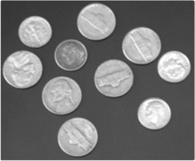
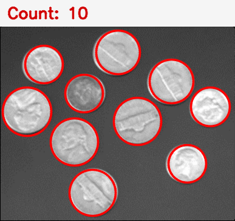

# 硬币自动计数

机器视觉技术与应用 · 编程练习 02 · 目标计数

使用 C++17 和 OpenCV 检测硬币外缘，在每个目标上绘制红色圆圈，并在图像顶部显示总数。课程样图实跑结果为 **10 枚**。

## 在 VS Code 中运行

1. 选择 **文件 → 打开文件夹**，打开 `coin_counting` 工程目录。
2. 打开 `src/main.cpp` 查看源码。按 **F5**，选择 **运行硬币计数 (MSVC)**。
3. 程序会编译并读取 `assets/coins.png`，弹出结果窗口。按任意键退出，生成的标注图保存在 `results/coins_counted.png`。

沿用本机课程环境，需要 VS Code C/C++ 扩展、MSVC Build Tools 和 OpenCV 4.12.0，`OPENCV_ROOT` 指向 OpenCV 构建目录。迁移时按实际安装位置和版本调整 `build.cmd`。

在工程目录内也可用 PowerShell 运行：

```powershell
.\build.cmd
$env:Path = "$env:OPENCV_ROOT\x64\vc16\bin;$env:Path"
.\build\coin_counting.exe --no-gui
```

可在 `--no-gui` 前指定其他图片路径。每次运行会覆盖 `results/` 内的结果图。

## 算法

先转灰度并用 5×5 高斯滤波减弱纹理噪声，再用霍夫圆变换估计每个硬币的圆心和半径。圆心最小间距和半径范围按图像短边设置，以减少同一枚硬币被重复检测。以检测到的圆数作为总数，不预设硬币数量。

参数以课程样图为基准。硬币尺寸相对画面变化较大、外缘被遮挡或背景出现圆形纹理时，可能需要调整检测参数。

| 输入原图 | 标注结果 |
| --- | --- |
|  |  |
