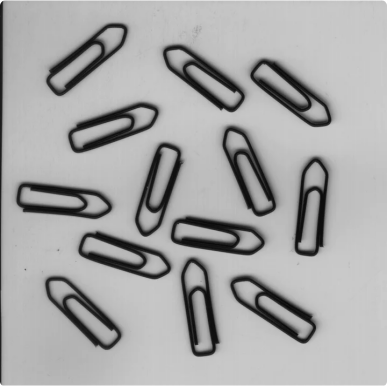
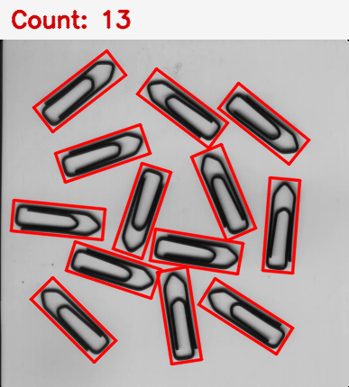

# 回形针自动计数

机器视觉技术与应用 · 编程练习 01 · 目标计数

使用 C++17 和 OpenCV 检测浅色背景上的深色回形针。程序为每个目标绘制红色旋转矩形，在图像顶部显示总数，并把标注图保存到 `results/paperclips_counted.png`。

## 在 VS Code 中查看和运行

1. 在 VS Code 中选择 **文件 → 打开文件夹**，打开 `paperclip_counting`。这样 VS Code 会读取这个工程的编译和调试配置。
2. 在左侧资源管理器打开 `src/main.cpp` 查看源码。运行时按 **F5**，如出现选项，选择 **运行回形针计数 (MSVC)**。
3. 程序会编译并处理 `assets/paperclips.png`。在弹出的窗口查看红框和总数，按任意键退出。此次运行的输出保存在 `results/paperclips_counted.png`。

本机沿用课程环境，需要 VS Code 的 C/C++ 扩展、MSVC Build Tools、OpenCV 4.12.0，以及指向 OpenCV 构建目录的 `OPENCV_ROOT`。迁移到其他电脑时，按实际安装位置和版本调整 `build.cmd`。

也可以在工程目录中使用 PowerShell 编译并运行，不弹出窗口：

```powershell
.\build.cmd
$env:Path = "$env:OPENCV_ROOT\x64\vc16\bin;$env:Path"
.\build\paperclip_counting.exe --no-gui
```

要处理其他图像，把图像路径放在参数里，例如 `.\build\paperclip_counting.exe assets\another.png --no-gui`。结果保存到同一文件，重新运行会覆盖上次结果。

## 算法

1. 转为灰度图，用 3×3 高斯滤波减弱小噪点。
2. 用 Otsu 方法自动选择灰度阈值，并反向二值化，使深色回形针成为白色前景。
3. 用小核闭运算弥合局部断点，再提取外轮廓；内部孔洞不会被单独计数。
4. 用轮廓面积排除小噪点，去掉接触图像边缘的扫描边框等成分；为每个剩余轮廓计算最小外接矩形，绘制红框并统计总数。

课程样图实跑结果：**13 个**。方法适用于背景较均匀、目标彼此分离的图像；相接或重叠的回形针可能被计成一个，贴边目标会被过滤。

## 样图与结果

| 输入原图 | 标注结果 |
| --- | --- |
|  |  |

`docs/` 中保留本次验证的结果图。以后运行生成的图像写入 `results/`。
