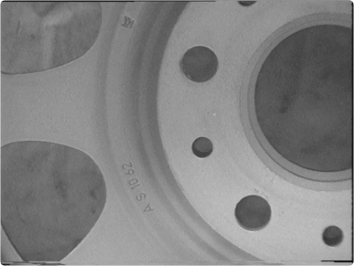
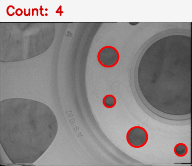

# 圆孔识别检测

机器视觉技术与应用 · 编程练习 03 · 特征检测

用 C++17 和 OpenCV 检测金属件上的完整小圆孔。对未标注的课程原图实跑，红圈标出了指定的 **4 个圆孔**。

## 在 VS Code 中运行

打开 `circular_hole_detection` 工程文件夹。主程序在 `src/main.cpp`。按 **F5** 并选择 **运行圆孔识别检测 (MSVC)**，程序会编译并显示检测结果，按任意键退出。结果同时保存到 `results/holes_detected.png`。

本机沿用课程的 VS Code C/C++ 扩展、MSVC Build Tools、OpenCV 4.12.0 和 `OPENCV_ROOT` 配置。迁移时根据实际安装位置调整 `build.cmd`。默认输入为 `assets/holes.png`，也可运行 `build\circular_hole_detection.exe [图片路径] --no-gui` 只保存结果。命令行运行时需让 OpenCV 的 DLL 目录在当前终端的 PATH 中。

## 检测原理

灰度图经高斯滤波后，用霍夫圆变换找候选圆。按图像短边限定半径范围，排除大孔和轮缘。候选圆及其外侧采样环必须完整落在图内，然后沿圆周对比内外灰度。仅保留多数方向呈现「孔内暗、孔外亮」的候选圆。

程序根据图像计算圆心、半径和数量。半径范围与灰度差阈值基于本练习场景，换用其他工件或光照时可能需要调整。

| 输入原图 | 检测结果 |
| --- | --- |
|  |  |
