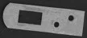
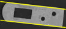

# 边缘与长边检测

机器视觉技术与应用 · 编程练习 04 · 特征检测

本次作业第 1 项包含两部分：用 Canny 提取工件和孔的边缘，以及在原图上用黄色直线标出工件外轮廓最长的两条直边。

| 原图 | Canny 边缘 | 两条最长边 |
| --- | --- | --- |
|  |  |  |

## 在 VS Code 中运行

打开 `edge_line_detection` 工程文件夹，按 **F5**，选择 **运行边缘与长边检测 (MSVC)**。程序会弹出两个放大后的预览窗口，按任意键退出。原始尺寸的结果保存到 `results/canny.png` 和 `results/long_edges.png`。主程序在 `src/main.cpp`。

构建沿用课程的 MSVC Build Tools 和 OpenCV 4.12.0，`OPENCV_ROOT` 指向 OpenCV 构建目录。命令行可在工程目录执行 `build.cmd`，再运行 `build\edge_line_detection.exe --no-gui` 仅生成图片。当前终端需能找到 OpenCV DLL。

## 检测方法

1. 灰度化并用 3×3 高斯滤波减弱噪声，再用 Canny 提取边缘。
2. 对灰度图做 Otsu 二值化，找出面积最大的外轮廓，再做多边形近似。
3. 按轮廓线段长度取前两条，沿各自方向延伸到图像边界。控制台会输出延伸前的端点和像素长度。

原图验证得到上边约 92.54 px、下边约 90.45 px。这里标定的是图像中的直线位置。线段长度受低分辨率和轮廓近似影响，以像素表示。
