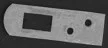
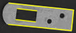

# 工件直边提取

机器视觉技术与应用 · 编程练习 05 · 特征检测

从原图提取参考图标出的 5 条直边。工件外轮廓取上下两条长边及连接它们的右端直边，矩形开口取上下两条长边。黄色线段保留检测到的端点。

| 原图 | 提取结果 |
| --- | --- |
|  |  |

## 运行

在 VS Code 打开 `edge_segment_extraction` 文件夹，按 **F5**，选择 **运行工件直边提取 (MSVC)**。主程序在 `src/main.cpp`。终端输出各线段端点和像素长度，标注图保存到 `results/straight_edges.png`。程序弹出放大预览，按任意键退出。

构建沿用课程的 MSVC Build Tools 和 OpenCV 4.12.0，`OPENCV_ROOT` 指向 OpenCV 构建目录。在工程目录执行 `build.cmd` 后，也可运行 `build\edge_segment_extraction.exe --no-gui` 生成图片，当前终端需能找到 OpenCV DLL。

## 方法

高斯滤波后用 Otsu 二值化，按轮廓层级分离工件外轮廓和内部开口。取面积最大的内部开口，再对它和工件外轮廓做多边形近似。外侧三条边按长度和端点连接关系选出。

对矩形开口，先用多边形定位大致轮廓，再沿各边的法线搜索原始灰度图中由亮到暗的变化峰值。用多个点拟合直线，相邻直线的交点给出角点，最后绘制两条长边。这能减少低分辨率下少数角点偏差对斜率的影响。方法以样图中的亮工件、深色背景及开口几何为前提。
