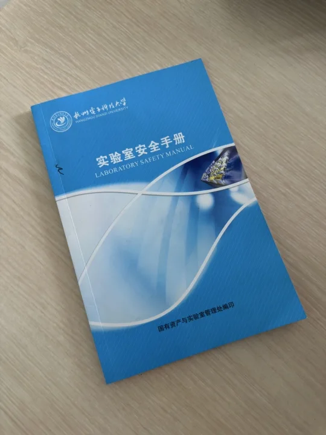

# 书本透视矫正

机器视觉技术与应用 · 编程练习 07 · 几何变换

用 C++ 和 OpenCV 自动定位木纹背景上的蓝色书封面，将四角映射到竖直矩形。样图实跑得到 345 × 472 像素的封面图。

| 原图 | 矫正结果 |
| --- | --- |
|  |  |

## 运行

在 VS Code 单独打开 `book_rectification` 工程文件夹，按 **F5**，选择 **运行书本透视矫正 (MSVC)**。主程序位于 `src/main.cpp`。程序会显示原图和矫正图，按任意键退出。结果保存到 `results/rectified_book.png`，终端会输出检测到的四角和结果尺寸。

构建沿用课程的 MSVC Build Tools 和 OpenCV 4.12.0，`OPENCV_ROOT` 指向 OpenCV 构建目录。在工程目录执行 `build.cmd` 后，可运行 `build\book_rectification.exe --no-gui` 只保存图片。当前终端需能找到 OpenCV DLL。

## 方法

在 HSV 空间提取蓝色区域，用形态学闭运算连接局部间断。取最大轮廓并计算凸包，以跨过浅色图案造成的边界缺口。用多边形近似找到四角，再采用透视变换映射到矩形，并从四边向内裁 2 像素。

输出宽高由原图的对边长度估计。方法依赖蓝色封面与背景的颜色差异。若已知书本实测宽高比，可按该比例设置目标矩形。
