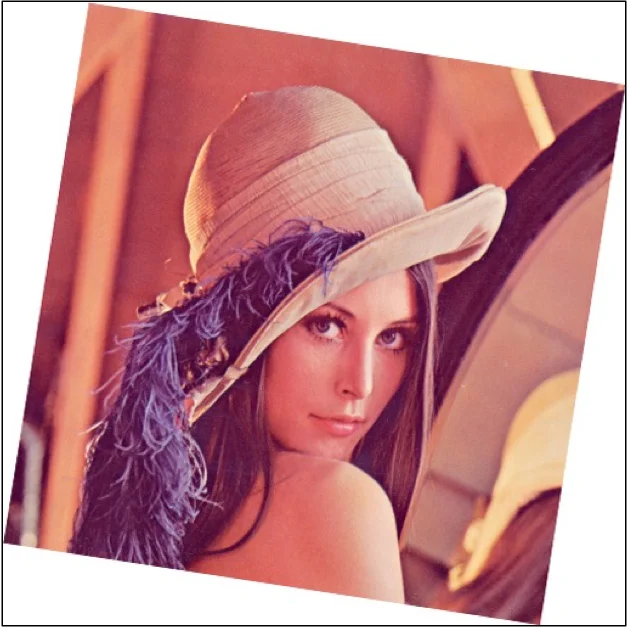
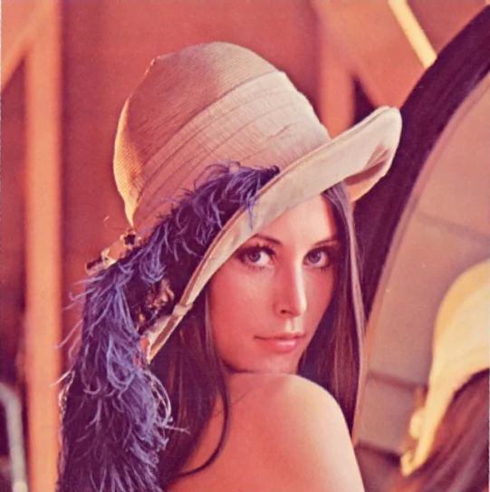

# 图像倾斜矫正

机器视觉技术与应用 · 编程练习 06 · 几何变换

用 C++ 和 OpenCV 自动估计照片的平面倾斜角，旋转后裁出照片主体。课程样图的矫正角约为逆时针 **8.61°**，输出尺寸为 **541 × 543 像素**。

| 输入原图 | 矫正结果 |
| --- | --- |
|  |  |

## 运行

在 VS Code 单独打开 `image_deskew` 工程文件夹，按 **F5**，选择 **运行图像倾斜矫正 (MSVC)**。主程序位于 `src/main.cpp`。程序会显示原图和矫正图，按任意键退出。结果保存到 `results/straightened.png`，终端会显示矫正角和输出尺寸。

构建沿用课程的 MSVC Build Tools 和 OpenCV 4.12.0，`OPENCV_ROOT` 指向 OpenCV 构建目录。在工程目录执行 `build.cmd` 后，可运行 `build\image_deskew.exe --no-gui` 只保存结果。当前终端需能找到 OpenCV DLL。

## 方法

建立近白色背景掩膜，忽略输入外圈的薄黑框，提取最大外轮廓。用最小面积外接矩形估计照片中心、尺寸和倾角，再用仿射变换完成旋转与裁切。裁切范围略向内收，去除插值产生的边缘杂色。

方法适合白底上的矩形照片整体发生轻微平面旋转的情况。若输入存在透视形变，需要另行定位四角并做透视矫正。
